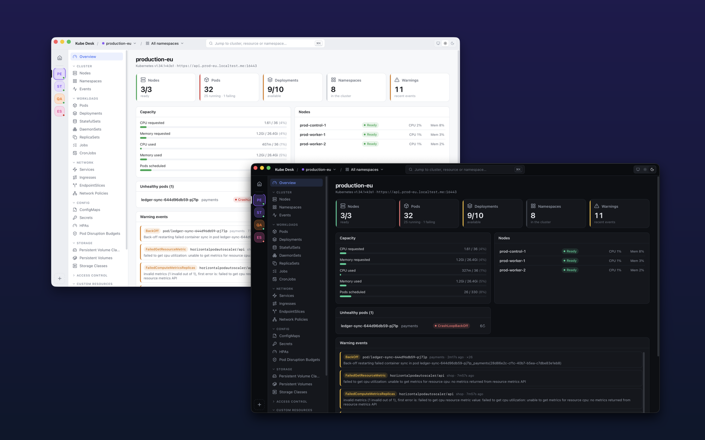
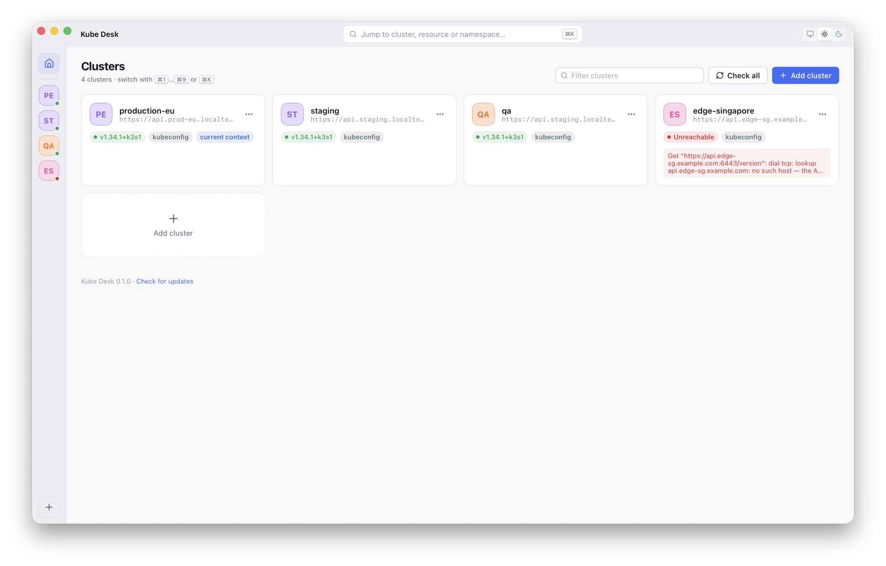
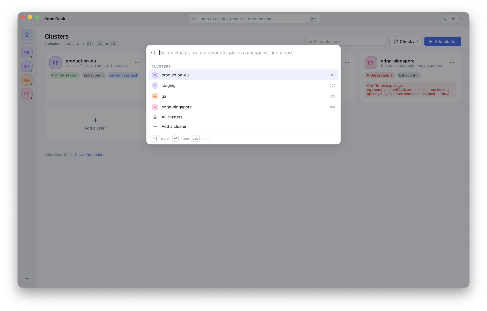
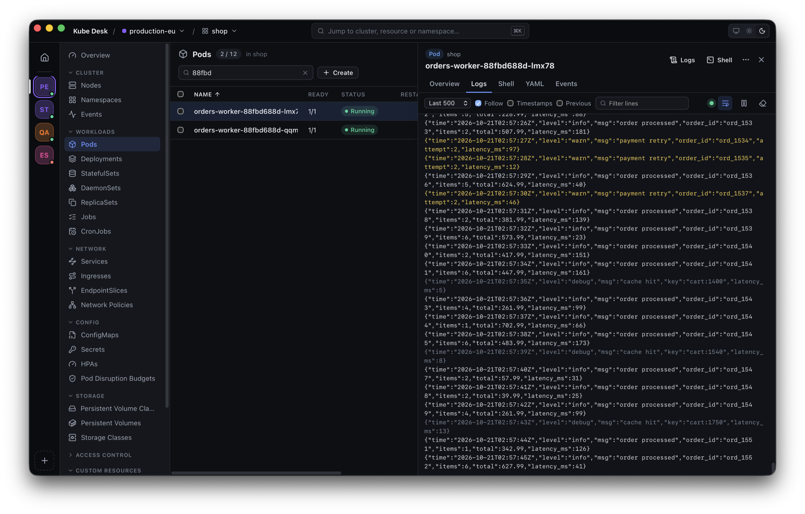
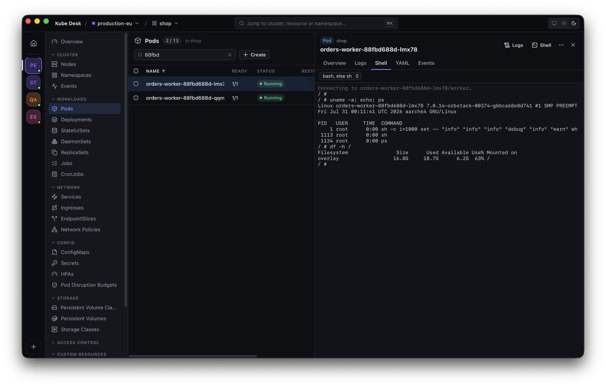
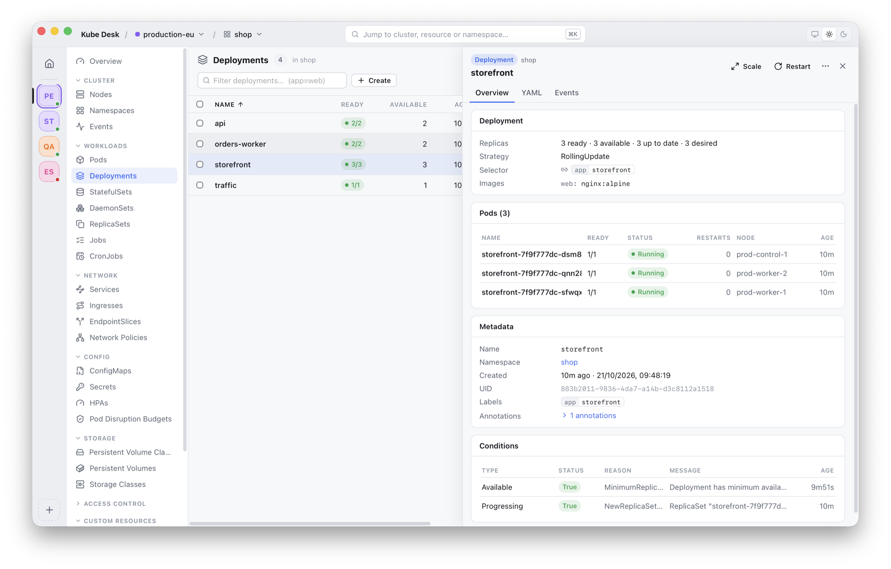
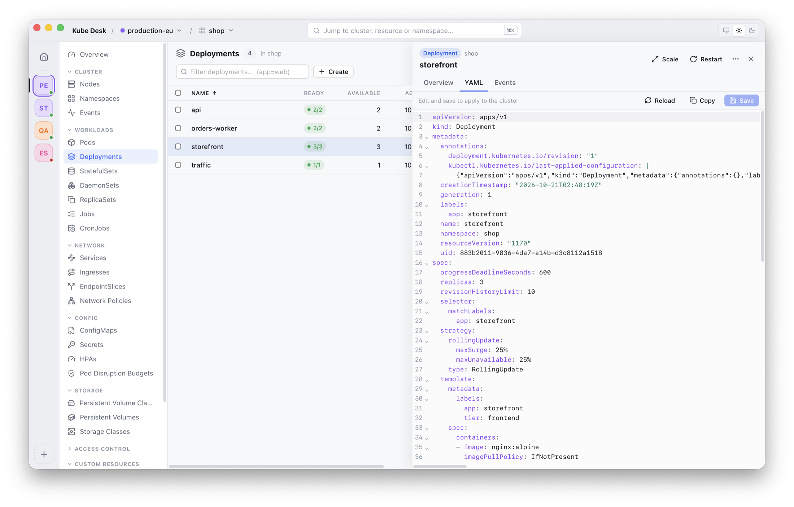
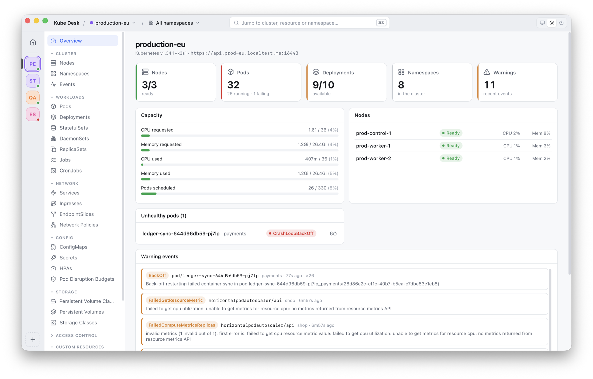
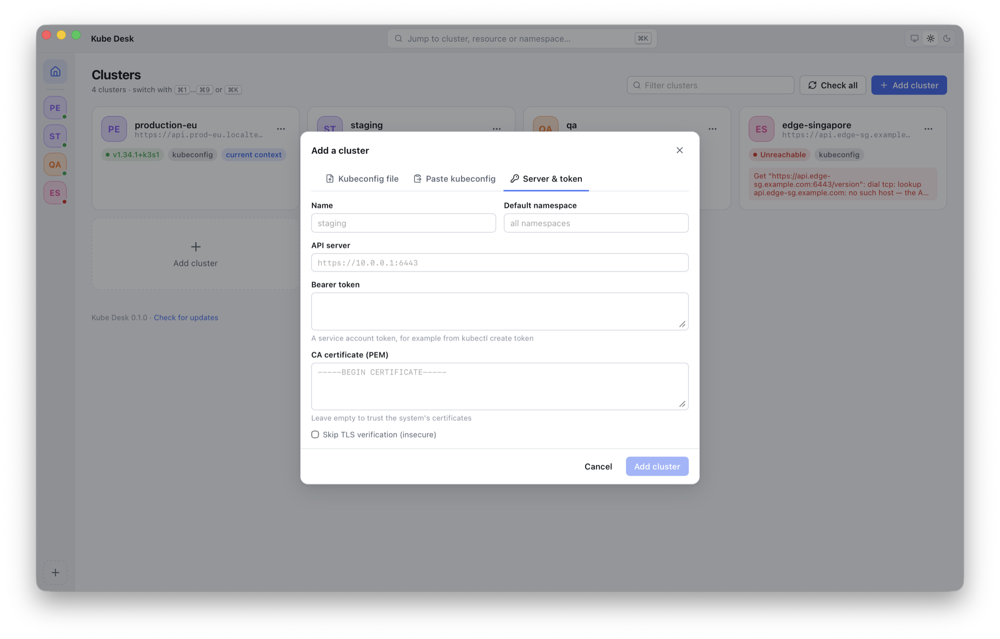

<div align="center">

# Kube Desk

**A fast, native-feeling Kubernetes desktop client for people who juggle many clusters.**

Browse, debug and operate every cluster in your kubeconfig, and the ones you
paste in, from one small app. Switch clusters in a keystroke, watch resources
change live, tail logs, open a shell, edit YAML.

[Website](https://kubedesk.cloud/) ·
[Download for macOS, Linux and Windows](https://kubedesk.cloud/download.html) ·
[Features](#features) ·
[Screenshots](#screenshots) ·
[Build from source](#build-from-source) ·
[Changelog](CHANGELOG.md) ·
[Tiếng Việt](README.vi.md)




</div>

## Why

Kube Desk takes the parts of [Headlamp](https://headlamp.dev) and
[Lens](https://k8slens.dev) you use every day and makes switching between
clusters the core of the app:

- **One app for every cluster.** It reads every context in `~/.kube/config` and
  `$KUBECONFIG`. Add more by picking a file, pasting a kubeconfig, or entering a
  server and a token.
- **Switching is instant.** Each cluster keeps its own page, namespace and open
  object, and its data stays live for a while after you leave. Coming back
  shows it as you left it.
- **Small and light.** One Go binary, about 47 MB, built with
  [MyGo](https://github.com/egoist/mygo). It uses the system's WebView instead
  of bundling Chromium.
- **Your kubeconfig is never modified.** Clusters you add in the app live in
  the app's own data folder.

## Features

**Clusters**
- Contexts from `~/.kube/config` and `$KUBECONFIG`, plus kubeconfig files read
  in place, so they pick up changes when `gcloud`, `aws` or `az` rewrite them
- Add a cluster by pasting a kubeconfig or entering an API server and bearer
  token (custom CA, or skip TLS verification)
- Rename, recolor, hide, drag to reorder and remove clusters; health and
  version at a glance
- Switch with the cluster rail, <kbd>⌘1</kbd>…<kbd>⌘9</kbd>, or the
  <kbd>⌘K</kbd> command palette. <kbd>⌘0</kbd> goes back to all clusters
- Exec credential plugins (GKE, EKS, AKS/kubelogin, OIDC) work even when the
  app is opened from Finder, because it loads your login shell's `PATH`

**Resources**, all updated live through watches
- Cluster: Nodes, Namespaces, Events
- Workloads: Pods, Deployments, StatefulSets, DaemonSets, ReplicaSets, Jobs, CronJobs
- Network: Services, Ingresses, EndpointSlices, NetworkPolicies
- Config: ConfigMaps, Secrets (reveal and copy values), HPAs, PodDisruptionBudgets
- Storage: PersistentVolumeClaims, PersistentVolumes, StorageClasses
- Access control: ServiceAccounts, Roles, RoleBindings, ClusterRoles, ClusterRoleBindings
- Custom resources: every CRD, with the columns it declares (`additionalPrinterColumns`)

**Watchlist and notifications**
- Watch a namespace, or a whole cluster, from the title bar or <kbd>⌘K</kbd>
- Kube Desk keeps watching in the background, also with its window closed,
  and sends a macOS notification when a pod crash loops, runs out of memory,
  fails to pull its image or cannot be scheduled, a rollout gets stuck, or a
  node goes down. When many things break at once, you get one notification
- A menu bar icon counts the problems and lists them. Click a problem, or its
  notification, to open the object; pause notifications for an hour

**Timeline of changes**
- In watched namespaces, every change is recorded for 7 days: what changed in
  plain words, who changed it (kubectl, Helm, Argo CD, a controller), and a
  diff of before and after. Restarts, readiness and warning events too
- Changes made while Kube Desk was closed are found when it starts again
- Secret values never reach the timeline, only which keys changed

**Before and after a problem**
- Deleting, scaling, restarting or draining shows first what else it breaks:
  services without endpoints, ingress routes, disruption budgets, pods with no
  controller, data in emptyDir or volumes, pods that would not fit elsewhere
- **Incident report**: a pod's or workload's state, events, logs (and those
  before the last restart), node and recent changes in one Markdown report,
  with tokens and passwords masked

**Helm releases**
- Every release with its chart, app version, revision and status, read from
  the cluster: no helm command needed to look
- Values (given, or with the chart's defaults), the rendered manifest, notes,
  the objects deployed, and the history
- Diff two revisions; roll back, with what changes and what Helm deletes
  shown first

**A map of how things connect**
- Each app of a namespace, left to right: ingresses, services, workloads,
  pods, and the config maps, secrets and claims they use, with their state
- Services with no pods, ingresses pointing nowhere and missing config stand
  out; each workload has a Map tab of the part it belongs to

**Promote, snapshots and runbooks**
- Promote an object to another cluster, with its config: change the
  namespace and images, see the diff there, and what it lacks
- Snapshot a namespace into a `.kubedesk` file that anyone opens in Kube
  Desk, as a read-only cluster, without access to yours. Secret values never
  go in it
- Runbooks: what to do when something fails, in Markdown, with buttons for
  the app's actions, shown with the objects they are for. The assistant
  follows them

**An assistant in the app**
- <kbd>⌘J</kbd> opens a chat with Claude in Microsoft Foundry (your Azure API
  key, kept in the macOS keychain) or in Google Vertex AI (your gcloud login)
- It sees every cluster in Kube Desk and what you have open, reads resources,
  logs, events, the timeline and incident reports, and shows each step
- Changes it proposes wait for your approval, with a diff, their impact and
  its reason
- Chats are saved, to go on with them later

**AI agents, with you approving every change**
- Kube Desk is an MCP server for Claude Code, Cursor, Codex, Claude Desktop
  and other MCP clients. Choose per cluster what agents may do: nothing, read,
  or propose changes
- Agents read resources, logs, events, the timeline and incident reports,
  search and compare clusters, and preview impacts
- Every change an agent proposes (apply, delete, scale, restart) waits for
  your approval in Kube Desk, with a diff, what it affects and the agent's
  reason. Secret values never reach agents

**Many clusters as one**
- <kbd>⇧⌘F</kbd> searches every cluster at once: names, `image:`, `app=web`,
  `kind:`, `ns:`, `node:`, `is:failing`
- Compare a workload, service, config map or secret across clusters, with
  what differs highlighted and a YAML diff

**Access and credentials**
- Buttons follow your RBAC: what your user may not do is disabled, with why
- Kubeconfig health: certificates and tokens that expired or soon will,
  missing credential plugins (with how to install them), removed auth
  providers, clusters added twice

**Production guardrails**
- Mark a cluster as production: it shows in red, and every change (delete,
  scale, restart, drain, saving YAML…) asks you to type the cluster's name
- Read-only clusters refuse every change and shell. The Go side enforces it,
  so it holds for every action, not just the buttons that are hidden
- Clusters whose names look like production offer to be protected

**Working with them**
- Cluster overview: node health, pod status, CPU and memory requested and used
  (with metrics-server), unhealthy pods and recent warnings
- Detail views for each kind: containers, ports, probes, conditions, owned
  pods, events, linked objects
- YAML editor with highlighting, folding and search; <kbd>⌘S</kbd> applies
- Create resources from YAML or templates, including several documents at once
- Delete (also in bulk), scale, rollout restart, cordon, uncordon and drain,
  run a CronJob now, suspend and resume
- **Logs**: live tail, container picker, previous container, timestamps,
  filter, wrap, coloring by level, save to a file
- **Logs of a whole workload**: every pod of a Deployment, StatefulSet,
  DaemonSet, Job or Service, interleaved by time and colored by pod; pods
  that start during a rollout join in
- **CPU and memory** of pods and nodes in their lists (with metrics-server)
- **Shell** into any container (bash, with sh as fallback)
- **Port forwarding** from pods and services, listed in the title bar
- Filter lists by text or `label=value`, sort any column, select rows for bulk
  actions

**Plugins**
- Plugins add pages, details tabs and sections, menu actions, list columns,
  ⌘K commands, title-bar buttons and overview cards, with settings of their own
- Find them in **Plugins** (⌘K) or the [marketplace](https://kubedesk.cloud/plugins.html),
  from Kube Desk's signed registry, or install one from a file or an address;
  archives are checked, and updates offered
- Off until you turn them on; their changes go through the app's diff and
  confirmation. Write your own with the [plugin SDK](plugin-sdk/README.md)

**App**
- Light, dark, or follow the system
- Updates itself: signed releases, delta updates, a Sparkle-style update window

## Screenshots

| | |
|---|---|
|  **All your clusters**, with health and version |  **⌘K**: jump to any cluster, page, namespace or pod |
|  **Live logs**, colored by level |  **Shell** into a container |
|  **Details** of every kind, with the pods it owns |  **Edit YAML** and apply with ⌘S |
|  **Cluster overview** |  **Add clusters** from files, pasted kubeconfigs or tokens |

## Install

### macOS

1. Download **[Kube-Desk-latest-arm64.dmg](https://pub-e3b2030c705649ef87d35925ea3331eb.r2.dev/Kube-Desk-latest-arm64.dmg)**
   (Apple silicon, macOS 12 or later) and drag Kube Desk to Applications.
2. Releases are not notarized yet. The first time, right-click the app and
   choose **Open**, or run:

   ```sh
   xattr -dr com.apple.quarantine "/Applications/Kube Desk.app"
   ```

After that, Kube Desk checks for updates daily. You can also check from
**Kube Desk → Check for Updates…**.

### Linux

Install for yourself in `~/.local`, without root, and get updates
automatically:

```sh
curl -fsSL https://pub-e3b2030c705649ef87d35925ea3331eb.r2.dev/install.sh | sh
```

Or install the Debian package, for
[x64](https://pub-e3b2030c705649ef87d35925ea3331eb.r2.dev/Kube-Desk-latest-linux-amd64.deb) or
[arm64](https://pub-e3b2030c705649ef87d35925ea3331eb.r2.dev/Kube-Desk-latest-linux-arm64.deb):

```sh
sudo apt install ./Kube-Desk-latest-linux-amd64.deb
```

Kube Desk needs GTK 3 and WebKitGTK 4.1 (`libwebkit2gtk-4.1-0` on Debian and
Ubuntu, `webkit2gtk4.1` on Fedora, `webkit2gtk-4.1` on Arch). The assistant
keeps its API key in the Secret Service (GNOME Keyring, KWallet…).

### Windows

Download **[Kube-Desk-Setup-latest-amd64.exe](https://pub-e3b2030c705649ef87d35925ea3331eb.r2.dev/Kube-Desk-Setup-latest-amd64.exe)**
(Windows 10 or 11, x64) and run it. The installer isn't signed yet, so
SmartScreen may warn: choose **More info → Run anyway**. Kube Desk uses
WebView2, which comes with Windows, and keeps updating itself.

## The assistant

1. Make Claude available to you, in either cloud:
   - **Microsoft Foundry**: deploy a Claude model in
     [Foundry](https://ai.azure.com/), for example `claude-opus-5-5`, and
     `claude-opus-4-8` as a fallback.
   - **Google Vertex AI**: enable the Claude model in
     [Model Garden](https://console.cloud.google.com/vertex-ai/model-garden),
     and run `gcloud auth application-default login` once.
2. In Kube Desk, open **Assistant settings** (<kbd>⌘K</kbd>). For Foundry,
   enter the resource name or the deployment's Target URI, the API key, and
   the deployment name; for Vertex AI, the project and the region.
   **Save and test** checks the connection.
3. Press <kbd>⌘J</kbd> and ask, for example *"Which pods are failing in
   this cluster, and why?"*

## Use with AI agents

1. In Kube Desk, open **AI agents** (the robot in the title bar, or <kbd>⌘K</kbd>)
   and turn on the MCP server.
2. Choose, for each cluster, what agents may do: **Off**, **Read** or
   **Propose changes**.
3. Copy the command for your client. For Claude Code:

   ```sh
   claude mcp add --transport http kubedesk http://127.0.0.1:47428/mcp \
     --header "Authorization: Bearer <token from Kube Desk>"
   ```

   Clients that start servers as processes (Cursor, Claude Desktop, Codex)
   run Kube Desk's bridge: `"/Applications/Kube Desk.app/Contents/MacOS/Kube Desk" mcp --config <path shown in the app>`.

Then ask, for example, *"Why is checkout failing in production-eu?"*: the
agent reads the incident report and recent changes. When it proposes a fix,
Kube Desk shows you the diff and what it affects before anything changes.

## Keyboard shortcuts

| Shortcut | Action |
|---|---|
| <kbd>⌘K</kbd> | Command palette: clusters, pages, namespaces, objects, theme, updates |
| <kbd>⌘1</kbd> … <kbd>⌘9</kbd> | Switch to the nth cluster |
| <kbd>⌘0</kbd> | All clusters |
| <kbd>⇧⌘F</kbd> | Search every cluster |
| <kbd>⌘J</kbd> | Open or close the assistant |
| <kbd>⌘F</kbd> | Filter the current list |
| <kbd>⌘S</kbd> | Apply the YAML being edited |
| <kbd>Esc</kbd> | Close the details panel |

Right-click a row or a cluster for more actions.

## Build from source

Requirements: [Go](https://go.dev/dl/) 1.27 or later and [Bun](https://bun.sh).
No C toolchain is needed; the build never uses cgo.

```sh
git clone https://github.com/ftech-vn/kubedesk.git
cd kubedesk
bun install
bun run dev      # the app with live reload (Vite on port 5188)
bun run build    # build/darwin-arm64/Kube Desk.app and a .dmg
```

Cross-compile with `bun run build -- -platform darwin/universal,linux/amd64,windows/amd64`.

Tests:

```sh
go test ./...                 # unit tests
K8S_LIVE=1 go test ./...      # also reads (never changes) your current context
K8S_DEMO=1 KUBECONFIG=throwaway.yaml go test -run TestDemoCluster ./...  # end-to-end on a throwaway cluster
bunx tsc --noEmit             # type-check the frontend
```

## How it works

```
┌──────────────────────── Kube Desk (one Go binary) ────────────────────────┐
│                                                                           │
│   System WebView (WKWebView / WebKitGTK / WebView2)                       │
│   ┌─────────────────────────────────────────────────────────────────┐     │
│   │  React + TypeScript UI: shared watch cache, CodeMirror, xterm.js │     │
│   └───────────────▲─────────────────────────────────┬───────────────┘     │
│                   │ typed events / channels         │ typed calls         │
│   ┌───────────────┴─────────────────────────────────▼───────────────┐     │
│   │  Go services (generated TypeScript client via MyGo)             │     │
│   │  Clusters: kubeconfig sources, prefs, connection cache          │     │
│   │  Kube: list/watch/apply/delete, logs, exec, port-forward        │     │
│   └───────────────────────────────┬─────────────────────────────────┘     │
└───────────────────────────────────┼───────────────────────────────────────┘
                                    │ client-go (dynamic client, SPDY/WebSocket)
                                    ▼
                         Kubernetes API servers
```

| Path | |
|---|---|
| `clusters.go` | Kubeconfig sources, stored clusters, preferences, connection cache keyed by file modification times |
| `kube.go` | Generic list/watch over the dynamic client, apply, delete, scale, restart, cordon/drain, CronJobs |
| `streams.go` | Logs (batched), logs of whole workloads, exec with a TTY, port forwarding |
| `shellenv.go` | Loads `PATH`/`KUBECONFIG` from the login shell for credential plugins |
| `alerts.go` | Watchlist: informers per cluster, problem rules, notifications, menu bar |
| `timeline.go`, `recorder.go` | The timeline: describing changes, storage, finding changes made while closed |
| `impact.go` | What a delete, scale, restart or drain would affect |
| `report.go` | Incident reports, and masking secrets in logs |
| `assistant.go`, `overview.go` | The assistant: Claude in Microsoft Foundry or Google Vertex AI, its tool loop, saved chats, the cluster overview |
| `promote.go`, `snapshot.go`, `runbook.go` | Promoting between clusters, namespace snapshots (served through fake clients), runbooks |
| `helm.go` | Helm releases, read from the Secrets Helm keeps; rollbacks through the helm command |
| `access.go`, `health.go` | What the user may do (SelfSubjectAccessReview), and kubeconfig health checks |
| `src/lib/graph.ts`, `src/views/ResourceMap.tsx` | The resource map: how objects connect, and its layout |
| `agents.go`, `mcp_bridge.go` | The MCP server, its tools and approvals, and the stdio bridge |
| `search.go`, `compare.go`, `plan.go` | Search across clusters, comparisons, diffs before applying |
| `updates.go` | Auto-updates and the application menu |
| `src/lib/` | Store (zustand), shared watch cache, resource definitions and columns |
| `src/views/`, `src/components/` | The UI |
| `scripts/release.sh` | Signed release build, published to Cloudflare R2 |

Each list in the UI goes through one shared watch per (cluster, resource,
namespace). The Go side lists, then watches from the list's resource version,
and starts over when the watch expires. The page batches changes and renders
them. Several views of the same list share one watch, and a watch stays open
for 90 seconds after its last view closes.

## Privacy and security

- Kube Desk only talks to the API servers in your kubeconfigs and to the
  update server, and, when you use the assistant, to the Foundry resource or
  Vertex AI project you set. There is no telemetry.
- It never writes to your kubeconfig files. Pasted kubeconfigs and tokens are
  stored with `0600` permissions in
  `~/Library/Application Support/Kube Desk/kubeconfigs/`.
- The assistant's chats are kept on your Mac only, with `0600` permissions, in
  `~/Library/Application Support/Kube Desk/assistant/`; Secret values never
  reach the assistant.
- Snapshots never hold Secret values, only a fingerprint of each, and mask
  tokens and passwords in logs. Snapshots you open are copied, with `0600`
  permissions, to `~/Library/Application Support/Kube Desk/snapshots/`.
- Updates are signed with Ed25519, and the app verifies the signature before
  installing.

## Roadmap

- [ ] Notarized macOS builds and a signed Windows installer
- [x] Linux and Windows releases (0.7.1)
- [x] Pod and node metrics in lists (0.2)
- [x] Logs of all the pods of a workload (0.2)
- [x] Watchlist with notifications and a menu bar icon (0.2)
- [x] Production and read-only clusters (0.2)
- [x] A local timeline of changes, also across restarts of the app (0.3)
- [x] One-click incident reports (0.3)
- [x] The impact of a change before deleting, scaling or draining (0.3)
- [x] Compare a workload across clusters, and search every cluster at once (0.4)
- [x] An MCP server for AI agents, with approval of each change in the app (0.4)
- [x] An assistant in the app, with approval of each change (0.5)
- [x] Helm releases: values, history, diffs between revisions, rollback (0.6)
- [x] A resource map, buttons that follow RBAC, kubeconfig health (0.6)
- [x] Diffs before applying YAML (0.4)
- [x] Namespace snapshots that open without access to the cluster (0.7)
- [x] Promote objects from one cluster to another, with a diff (0.7)
- [x] Runbooks attached to workloads (0.7)
- [ ] Cost estimates per namespace and app
- [x] Plugins and a marketplace: pages, tabs, actions, columns and commands (0.8)

## Contributing

Issues and pull requests are welcome. See [CONTRIBUTING.md](CONTRIBUTING.md).

## Acknowledgements

- [MyGo](https://github.com/egoist/mygo) by [@egoist](https://github.com/egoist), the desktop framework
- [client-go](https://github.com/kubernetes/client-go), [CodeMirror](https://codemirror.net), [xterm.js](https://xtermjs.org), [Lucide](https://lucide.dev)
- [Headlamp](https://headlamp.dev) and [Lens](https://k8slens.dev), for the inspiration

## License

[MIT](LICENSE)
